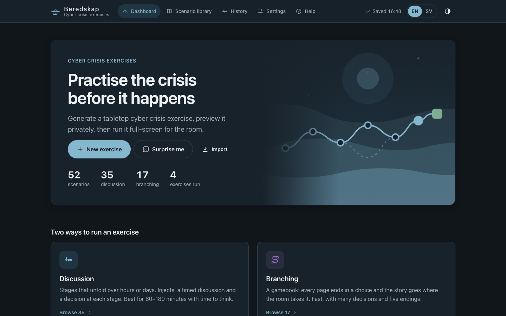
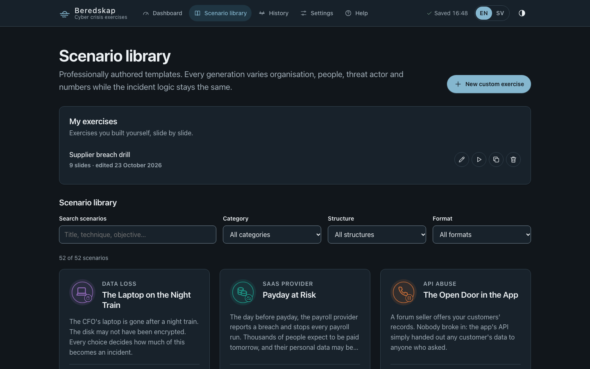
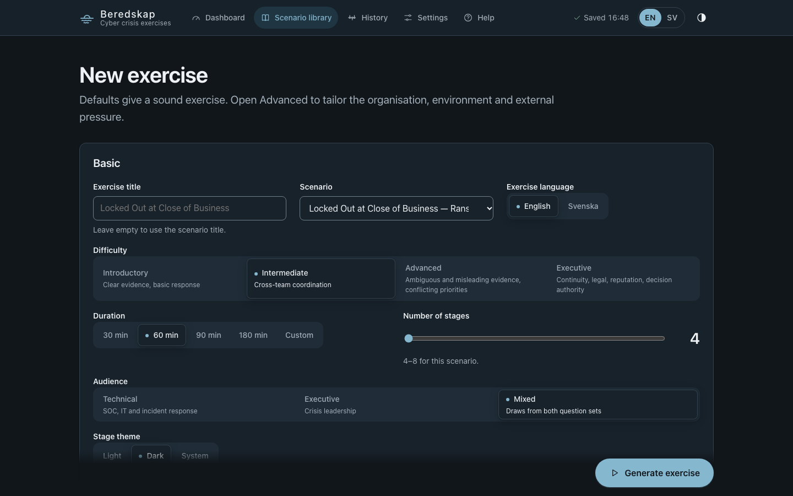
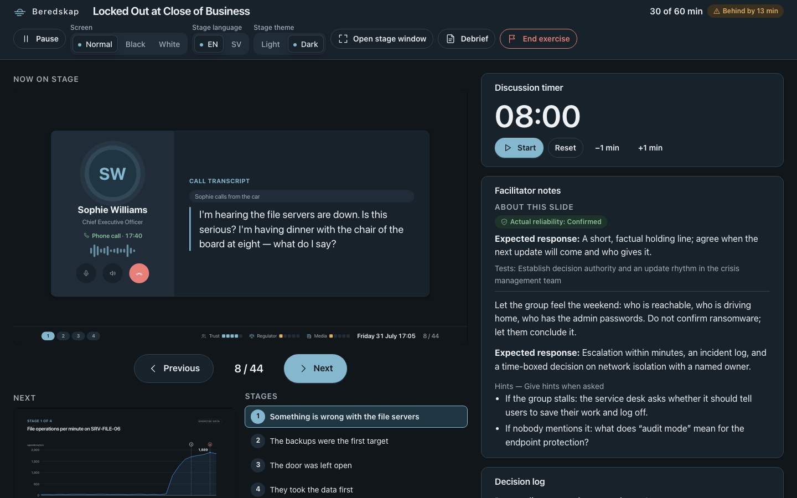
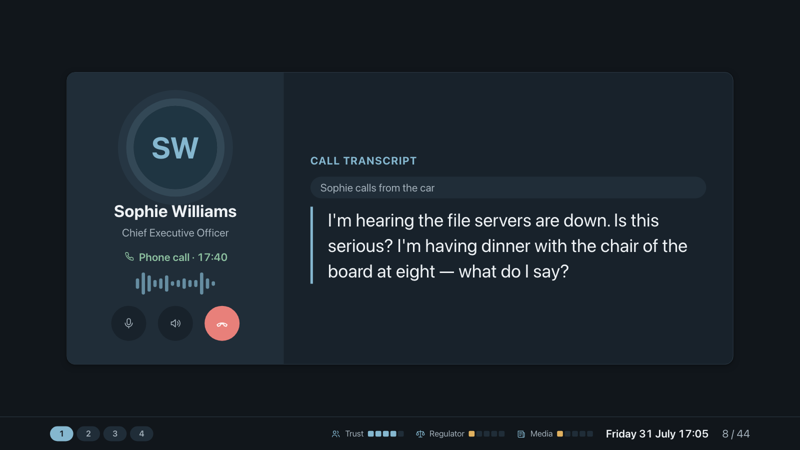
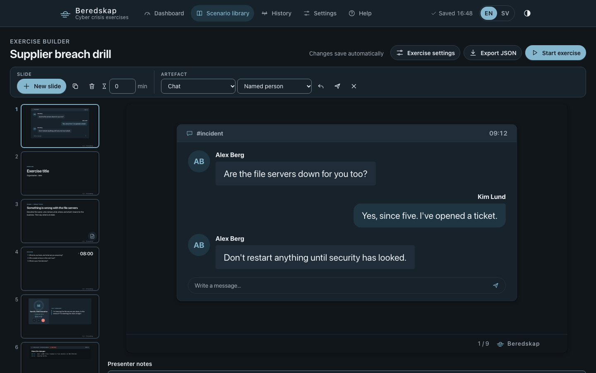
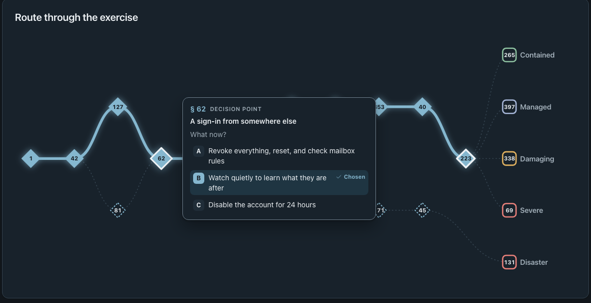
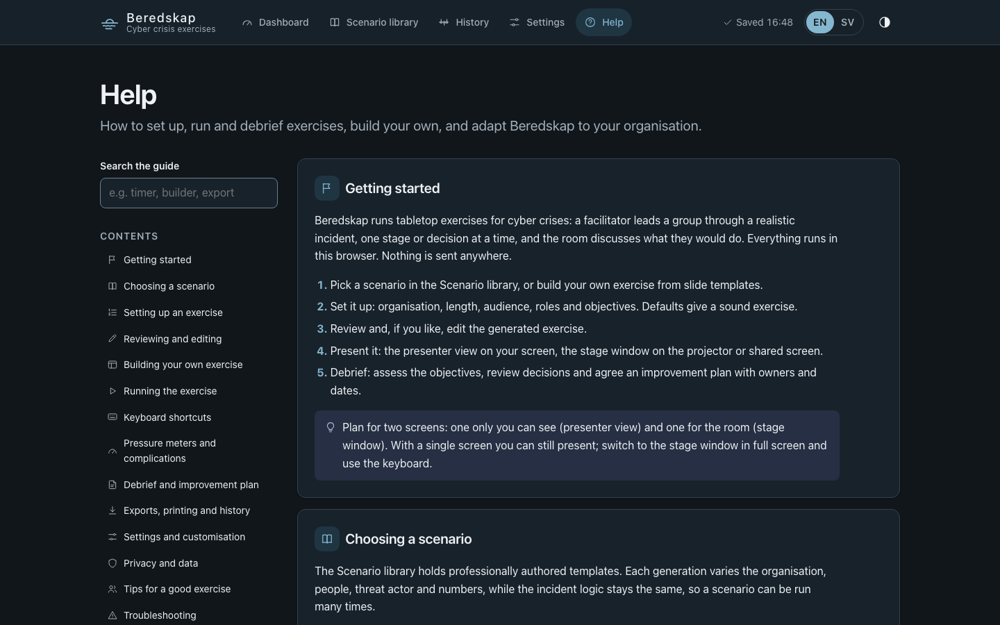

# Beredskap

**Tabletop exercises for cyber crises, in English and Swedish. Runs entirely in your browser.**

[](LICENSE)


**▶ Try it now: [jozeta.github.io/Beredskap](https://jozeta.github.io/Beredskap/)** (no sign-up; everything stays in your browser)

Beredskap (Swedish for *preparedness*) helps you plan and run tabletop exercises:
a facilitator walks a group through a realistic cyber incident, one stage or one
decision at a time, and the room discusses what they would do. Afterwards, you get a
debrief, an after-action report and an improvement plan with owners and due dates.

- **52 ready-made scenarios.** 35 *discussion* exercises unfold in stages, with injects
  (emails, chats, calls, alerts, news), a timed discussion and a decision. 17 *branching*
  exercises work like a gamebook: every page ends in a choice and the story follows the
  room to one of five endings. Topics range from ransomware, phishing and insider threats
  to supply-chain attacks, cloud outages, cryptomining, malicious npm packages, shadow AI
  and disaster recovery.
- **Build your own.** A slide editor with 53 templates (questions, decisions, email and
  chat threads, phone calls, social posts, alerts, logs, reports) lets you create custom
  exercises.
- **Two screens.** The room sees a clean 16:9 stage. You steer from a private presenter
  view with notes, hints, timers and the logs.
- **Private by design.** A single static web page with no backend, no build step, no
  dependencies and no tracking. The Content-Security-Policy blocks every network request,
  and everything is stored in your browser.

All organisations, people, domains (`*.example`) and IP addresses (RFC 5737 ranges) in
the generated content are fictional. Threat actors are invented, and no real group names
are used.

## Screenshots

| | |
|---|---|
|  |  |
| **Dashboard.** Start an exercise, resume a running one or open a recent one. | **Scenario library.** 52 scenarios to search and filter, plus your own exercises. |
|  |  |
| **Setup.** Organisation, length, audience, roles, objectives and extra pressure. | **Presenter view.** What the room sees, plus notes, hints, timer and logs. |
|  |  |
| **Stage.** The audience screen, with injects drawn as realistic mock-ups. | **Exercise builder.** Build your own exercise slide by slide. |
|  |  |
| **Debrief.** The route through a branching exercise; hover over a decision to see the options. | **Help.** A built-in guide in English and Swedish. |

## Features

- **Generated, consistent exercises.** Every generation rolls a fictional organisation,
  cast, threat actor, numbers and timeline from a seed. The same seed and settings always
  give the same exercise.
- **Tailoring.** Sector, size, technology vocabulary (for example Microsoft 365 or Google
  Workspace), jurisdiction (regulator, reporting rules, currency), audience (technical,
  executive or mixed), difficulty, inject density, participating roles, real participant
  names and learning objectives.
- **Facilitation tools.** Inject release, skip and postpone; a discussion timer; pacing
  ("behind by 5 min"); decision and observation logs; black and white screen; a clicker and
  keyboard shortcuts; and recovery after a reload.
- **Extra pressure (optional).** Pressure meters on the stage (customer trust, regulator
  attention, media) and a deck of 32 complication cards to draw during the run.
- **Debrief.** Learning objectives, what really happened (including what the room never
  found), decisions, a facilitator scorecard (an assessment, never a maturity score), MITRE
  ATT&CK, NIST CSF 2.0 and ISO/IEC 27001:2022 mapping, and an improvement plan.
- **Exports.** A printable after-action report (or PDF), Markdown, CSV (inject log,
  decision log, observations, action plan), JSON for archiving or moving to another
  computer, plus a printable facilitator guide and role cards.
- **Bilingual.** The interface, the stage and the exports are in English and Swedish. You
  can switch the stage language live.
- **Light and dark themes**, accessible keyboard navigation and WCAG AA colour contrast.

---

## Contents

1. [Installation](#1-installation)
2. [Quick start](#2-quick-start)
3. [Operator guide](#3-operator-guide)
4. [Keyboard shortcuts](#4-keyboard-shortcuts)
5. [Architecture](#5-architecture)
6. [Data model](#6-data-model)
7. [Authoring a new scenario](#7-authoring-a-new-scenario)
8. [Testing](#8-testing)
9. [Limitations](#9-limitations)
10. [License](#10-license)

---

## 1. Installation

**Just want to use it?** Open the hosted version at
**https://jozeta.github.io/Beredskap/**. It is the same static app; your
exercises are stored only in your own browser.

To run your own copy: Beredskap needs no installation and no build step. You only need a current Chrome, Edge or
Firefox.

**Option A: open it from disk.**

```sh
git clone https://github.com/jozeta/Beredskap.git
cd Beredskap
open index.html          # macOS; on Windows: start index.html, on Linux: xdg-open index.html
```

Everything works from `file://`.

**Option B: serve it locally.** This is recommended if you want to run all the tests.

```sh
cd Beredskap
python3 -m http.server 8000
# then open http://localhost:8000/
```

**Option C: host it.** Any static host can serve the folder unchanged, for example GitHub
Pages, Azure Static Web Apps, Netlify or an intranet web server. For GitHub Pages, go to
*Settings → Pages*, choose *Deploy from a branch*, pick `main` and the root folder. The
included `.nojekyll` file makes Pages serve the files whose names start with `_`.

**Requirements.** An evergreen browser with `BroadcastChannel`, `Intl`, `<dialog>` and
`localStorage`. For projection, use the stage window in full screen at 1920×1080; the stage
scales to any 16:9 size.

---

## 2. Quick start

### Run your first exercise (about five minutes)

1. Open **Scenario library** in the top menu and pick a scenario. *The Laptop on the Night
   Train* is a short branching exercise; *Locked Out at Close of Business* is a classic
   ransomware discussion exercise.
2. Choose **Use scenario**. The defaults give a sound exercise. Open *Advanced* to set the
   organisation, roles and objectives, then choose **Generate exercise**.
3. Read through the generated exercise in the private preview. Every inject, hidden fact
   and facilitator note is there. Edit any text you like.
4. Choose **Start exercise**, then **Presenter here + stage window**. Drag the stage window to the projector
   and press **F** for full screen. The window you started from becomes your presenter view.
5. Press **→** or click the stage to move forward. After the last question of a stage, the
   first click starts the discussion timer and the next click moves on. In branching
   exercises, press **1–4** (or use the presenter's buttons) to record the room's choice.
6. When you are done, choose **End exercise** and open the **Debrief**.

### Build your own exercise

1. In **Scenario library**, choose **New custom exercise**.
2. Choose **New slide** and pick templates from the gallery.
3. Click into any text on the slide to edit it. Use the toolbar for formatting, lists,
   icons, images and block order, and add messages to chat, SMS and call slides.
4. Give question slides a discussion timer, and write presenter notes under each slide.
5. Choose **Start exercise**. Your exercise is listed under *My exercises* in the library.

### Debrief and follow up

1. In the debrief, set each learning objective to addressed, partly addressed or not
   addressed, and add observations.
2. Build the **improvement plan**. Each action gets an owner, a due date, how you will know
   it is done, and a status. Adopt the scenario's suggestions with one click.
3. Print the report or export Markdown, CSV or JSON. Open actions from every exercise are
   collected under **History**.

### Need more?

Open **Help** in the top menu for the full guide: every setup option, the builder, pressure
meters and complications, shortcuts, exports, privacy, facilitation tips and
troubleshooting.

---

## 3. Operator guide

### 3.1 From zero to running (about one minute)

1. **Library** (`#/library`). Browse the 52 scenarios. You can filter by
   category, structure (archetype A–F) and format (discussion or branching), or
   search. A card's preview shows
   the summary, learning objectives, key lessons, stage titles and framework
   references. It never shows hidden facts.
2. **Setup** (`#/new`). Choose *Use scenario* on a card (or *New exercise* /
   *Surprise me* on the dashboard), then choose *Generate exercise*. The defaults give a sound exercise. *Advanced* covers:
   - sector, size and a fixed organisation name;
   - technology environment and jurisdiction;
   - which external pressures to include;
   - inject density;
   - participating roles, with optional real participant names;
   - learning objectives;
   - discussion time, inject release and decision mode;
   - extra pressure: pressure meters and the complication deck;
   - the seed.

   Every control changes the generated exercise. For a branching scenario,
   *Run as* (choice after choice, or with discussion stops) and *Length*
   (short or long, with the expected minutes and number of choices) replace
   duration and stage count.
3. **Preview and edit** (`#/edit/:id`). This is a private outline of everything:
   - every inject, with its reliability and visibility badges;
   - hidden facts, with the stage that reveals them;
   - the ground truth and the attacker timeline;
   - questions, decisions, facilitator notes, pacing and the slide order.

   You can edit any text (in the preview language), include or exclude optional
   injects, retime an inject within its stage, reorder slides within a stage,
   change the stage count, or reroll. From here you can also print the
   facilitator guide or the role cards.
4. **Start.** Choose between two ways to run:
   - **Presenter here + stage window** (recommended): the stage opens in a new window, which you
     drag to the projector and make fullscreen with `F`. This window becomes the
     presenter view.
   - **Single screen**: the stage opens fullscreen in this window. Facilitator
     notes are available in a private overlay (`N`), framed in red so you notice
     if it is being projected.

### 3.2 Running the exercise

- **Stage** (`#/stage/:id`). The participants see this. A stage runs:
  situation → timeline (one inject per step) → injects and data → twist →
  discussion with timer → decision → recap.
- **Presenter** (`#/presenter/:id`) shows:
  - current and next slide, rendered from exactly what the room sees;
  - facilitator notes, expected responses and hints;
  - hidden facts and when each is revealed;
  - upcoming injects;
  - the timers and pacing ("on time" / "behind by n min");
  - the decision and observation logs, learning objectives and a list for
    jumping to a stage.

  The presenter and stage stay in sync. Either window can drive.
- **Injects.** You can release an inject now, postpone it to the next stage,
  or skip it (optional injects only). When you are behind schedule, the
  presenter suggests which optional injects to skip.
- **Decisions.** Participants decide in their own words first. Authored options
  are aids only, and the log always records free text, rationale, dissent, open
  questions and the owner. A recorded decision can activate a branch, which
  adds consequences to a later stage. Branches never contradict facts already
  shown.
- **Pause** (`P`) freezes every clock and shows a calm "Paused" slide.
- **Recovery.** Every change autosaves. If a window is closed or reloaded,
  reopening it restores the exact slide and the logs, with timers paused.

### 3.3 Running a branching exercise

- **Pages and choices.** The stage shows a page (its gamebook number, "§ 212",
  and a few lines of story), any artefacts on it, and then the choice: 2–4
  options, numbered. When the options lead to different pages, each shows
  "turn to § N". The room argues it out; you record the choice with the
  presenter's *Choose* buttons or the keys `1`–`4` on the choice slide. *Next*
  does not move past an unmade choice.
- **Consequences.** Options set consequences (for example "Sessions revoked
  early") that change later pages, which options are offered, and which ending
  the room reaches. A page that reacts to an earlier choice says so on stage
  ("Because you revoked the sessions…"), and has its own page number.
- **Presenter.** For each option the presenter shows *why it matters*, the page
  it leads to and the consequences it sets, plus *what a strong team weighs*
  for the choice as a whole. It also lists the consequences in play and the
  route so far. *Undo last choice* (with a confirmation) steps back one choice
  after a misclick.
- **Length and mode.** Short runs take about 30 minutes and 10–11 choices;
  long runs add decision points to the same story (12–16 choices, 40–45
  minutes). With discussion stops, some pages first show 1–2 questions with
  the discussion timer.
- **Endings.** Every branching exercise has five endings on a scale from
  *Contained* to *Disaster*. The scale is for discussion, never a score. The
  stage debrief shows the route through the whole map: the room's path drawn
  strong, unvisited pages as numbers only. The operator debrief adds the page
  titles (hover over or tab to a decision point to see the options and the
  room's choice), every choice with the options not taken and where they led, and the
  endings that were not reached.

### 3.4 Debrief and exports

- **Debrief** (`#/debrief/:id`). This view collects:
  - the summary, plus learning objectives with their status;
  - the ground-truth reveal, including hidden facts the room never surfaced;
  - the full timeline with decisions;
  - assumptions versus reality, observations and unresolved risks;
  - the improvement plan: actions with owner, due date, how completion is
    verified and status (open, in progress, done, dropped), seeded from the
    scenario's suggestions and from observations;
  - the facilitator scorecard and the MITRE ATT&CK, NIST CSF 2.0 and ISO/IEC
    27001:2022 mapping.

  The scorecard is a facilitator's assessment against the scenario's
  evaluation criteria. It is not a maturity or compliance score.
- **Exports**:
  - **JSON**: the full exercise and session, schema-versioned.
  - **Markdown**: the after-action report.
  - **CSV**: the inject log, decision log, observations and action plan. Files are UTF-8 with a
    BOM, use the locale's separator and are guarded against formula injection.
  - **Print / Save as PDF**: the after-action report, the facilitator guide
    (marked confidential) and role cards.
- **History** (`#/history`) lists past and running sessions. From there you can
  reopen the presenter or debrief, export, run again, archive or delete. Open
  improvement actions from every debrief are collected below the list. Deleting asks for
  confirmation. Imports also start here. An import is validated in full before
  anything is stored, is always stored as a new copy, and is rendered as plain
  text.
- **Help** (`#/help`) is the built-in guide (14 topics, searchable).
- **Settings** (`#/settings`) holds the language, UI theme, default stage theme
  and default duration. You can also export all raw data, or clear it with a
  double confirmation.

### 3.5 Custom exercises, pressure meters and complications

- **Exercise builder** (`#/builder/:id`). Start it with *New custom exercise* in
  the library. Slides are listed on the left (drag, or Alt+↑/↓, to reorder),
  the selected slide is edited in place in the middle, and the toolbar adapts
  to the selection: layout, discussion timer, text formatting, lists, quotes,
  callouts, icons, key figures, timelines, A–D options, images, and the type,
  sender and messages of artefact slides. *New slide* opens a gallery of 53
  templates in six groups. Every slide can have presenter notes, which never
  reach the stage. Changes save automatically. *Export JSON* writes a deck file
  that imports from History. Custom runs use the same stage, presenter,
  observations, improvement plan and exports.
- **Pressure meters.** Customer trust, regulator attention and media pressure,
  shown on the stage from 0 to 5. You move them in the presenter; in branching
  exercises some options move them too.
- **Complication deck.** 32 short twists (people, technical, communication,
  legal, logistics, wildcard). Draw a card, read its private note, then show it
  on the stage or put it back. In automatic mode one card is readied per stage.

### 3.6 Language and theme

The UI, the stage and the exports are fully bilingual (EN/SV). On stage, `L`
switches language live. Names, numbers and times stay identical, because both
languages are resolved at generation time. The UI and stage themes are
independent (light, dark or system), and on stage `D` switches the theme live.

---

## 4. Keyboard shortcuts

These work on the stage and in the presenter. They are disabled while you type
in a field or a dialog is open. A presentation clicker (PageUp/PageDown, arrows,
`.`/B) can drive a whole run.

| Key | Action |
|---|---|
| → · Space · PageDown | Next step (reveal the next item, or go to the next slide) |
| ← · PageUp | Previous step |
| Home · End | First · last slide |
| 1–9, 0 | Jump to stage 1–10 (discussion exercises) |
| 1–4 | Choose option 1–4 on a choice slide (branching exercises) |
| T · Shift+T | Start/pause · reset the discussion timer |
| + · − | Add · remove one minute |
| P | Pause/resume the whole exercise |
| N | Private facilitator overlay (single-screen mode) |
| B or . · W | Black · white screen |
| F | Toggle fullscreen |
| L · D | Toggle language · stage theme, live |
| Esc | Leave fullscreen; a second Esc offers to exit to the presenter (the session is kept) |
| ? | Shortcut help |

In the operator UI, every control is reachable with Tab. A *Skip to content*
link comes first, and on each page change focus moves to the page heading.

---

## 5. Architecture

```
index.html          app shell; classic <script> tags in dependency order (works on file://)
tests.html          in-browser test runner
css/                tokens (light/dark), app, stage (1920×1080 canvas), presenter, print
js/core/            namespace (window.BK), store, rng, i18n, theme, safe DOM builders
js/data/            options/vocabulary, roles, sectors, environments, name pools, frameworks, complications, help
js/engine/          template resolver, generator, validator, pacing, slide compiler, branching, session, edit, custom (builder decks)
js/graphics/        icon sprite + emblems, SVG charts, route map, inject artefact mock-ups, title artwork
js/scenarios/       _registry, _helpers, s01 … s35 (discussion), b01 … b17 (branching), one file each
js/io/              export (JSON/Markdown/CSV), import (validation), print
js/ui/              router, sync, dialog, components, and one module per view (incl. builder, custom-slide, help)
js/app.js           boot: preferences, shell, routes, storage-problem banner
tests/              runner and test suites
docs/screenshots/   README images
```

**One global namespace.** Every file is an IIFE that attaches to `window.BK`.
Classic scripts, not ES modules, so the app runs from `file://`. The order in
`index.html` is the dependency order.

**Template → instance → session.** These are three separate layers:

1. A **template** (`js/scenarios/sNN-*.js`) is authored content with
   placeholders. It is frozen on registration and validated on load.
2. An **instance** (the "exercise") is what the generator produces from a
   template, the wizard parameters and a seed. All placeholders are resolved
   into both languages, and all variables are rolled. It is plain JSON, so it
   can be saved, edited and exported.
3. A **session** is a live run of an instance: position, timers, inject
   states, the decision and observation logs, objective status, scorecard and
   notes. Every change goes through `BK.engine.session.apply(session, command,
   now)`, which returns a new session. The function is pure and easy to test.

**Determinism.** `BK.rng` is mulberry32 seeded by an FNV hash of the seed text.
Each concern (people, numbers, clock, each chart…) uses a *named fork* of the
generator. The same seed and parameters therefore always give a deep-equal
instance, and changing one parameter (say, the stage count) does not reshuffle
unrelated choices such as people's names.

**The confidentiality boundary.** The stage never sees the session. It renders
only `session.project()`, the *audience projection*: released, public content,
already localised. Facilitator notes, expected responses, hidden facts before
their reveal, true reliability classifications, role-only injects and
unreleased injects are never copied into it. They are therefore never in the
stage DOM, not even hidden. Tests sweep every slide of every scenario, both
languages and every branch to enforce this (see [Testing](#8-testing)).

**Sync.** Session state lives in `localStorage`. A view opens it with
`BK.sync.open(sessionId, onChange)` and changes it only through the returned
`dispatch(command)`: the window applies the command, saves it and announces the
new revision on `BroadcastChannel("beredskap")`, with storage events as a
fallback. Other windows re-read the session and re-render.
Heartbeats record which windows are alive. That is how a reload knows whether
to pause the timers (no other window running) or carry on.

**Safe rendering.**
- All DOM is built with `BK.dom.el()` and `textContent`. Scenario, generated
  and imported content never passes through `innerHTML`.
- The single exception is the static icon sprite in `js/graphics/icons.js`.
- `el()` refuses inline event-handler attributes.
- There is no `eval`, no `new Function` and no string timers.
- The Content-Security-Policy is `default-src 'none'`, with only same-origin
  scripts, styles and images, and `connect-src 'none'`.
- A test reads the source and enforces all of this.

**Storage.** Keys are namespaced `beredskap:` (tests use `beredskap-test:`).
Every value is wrapped as `{ v: schemaVersion, savedAt, data }`. If saved data
is unreadable or from a newer schema, it is reported, never silently dropped.
The user can export the raw data, then reset. A "Saved" status in the header
confirms each autosave. If storage is full or blocked, a translated message
says so.

---

## 6. Data model

### Template (authored)

| Field | Meaning |
|---|---|
| `id`, `version`, `category`, `archetype`, `emblem` | Identity. Category and emblem are unique per scenario; `archetype` is one of the six structures A–F |
| `title`, `summary`, `learningObjectives[]` | Bilingual `{ en, sv }` text |
| `mitre[]`, `frameworks{ nistCsf[], iso27001[] }` | Framework mapping (ids must exist in `js/data/frameworks.js`) |
| `minStages`, `maxStages` | Stage-count range offered by the wizard (within 3–10) |
| `constraints{ startWindow, startTime?, sectors[] }` | When the incident starts (e.g. `friday-evening`, or a pinned `"03:00"`), and which sectors fit |
| `variables{ name: { min, max, step?, scaleBy?, currency? } }` | Numbers rolled per instance, available as `{{num.name}}` |
| `roles[]` | Every role the scenario may address |
| `groundTruth{ rootCause, attackerTimeline[] }` | What really happened (minutes relative to T+0). Fixed for every generation |
| `hiddenFacts[]{ id, revealStage, text }` | Facts the room learns only at a stage (or `"debrief"`) |
| `stages[]` | See below |
| `resolution{ type, text }` | `resolved` · `partial` · `open` |
| `debrief{ keyLessons, assumptionsVsReality, strengthsToLookFor, commonGaps, suggestedActions }` | Debrief content |

A **stage** has these fields:
- `id`, `mandatory`, `clock` (minutes from T+0);
- `title` and `narrative`;
- `twist`, `twistKind` (`cause | scope | impact | authority`) and
  `assumptionChallenged`, on every stage after the first;
- `reveals[]`;
- `injects[]` and `branchInjects[]`, plus `branches[]{ when: { decision,
  option? }, addInjects[], narrativeAppend? }`;
- `charts[]`, and `questions{ technical[], executive[] }` (with `revisits` on
  questions that look back at an earlier decision);
- `challenges[]`;
- `decision{ id, question, authority, options[], knowns[], uncertainties[],
  tradeoffs{}, evaluation[], discussionMinutes }`;
- `facilitator{ notes, expected, hints[] }`.

An **inject** has these fields:
- `id`, `at` (minutes from T+0);
- `type` (one of 26, e.g. `siemAlert`, `ransomNote`, `regulatorLetter`);
- `source`, `severity` and `reliability`
  (`confirmed | unverified | misleading | disputed`);
- `visibility` (`public | role:<roleId> | facilitator`);
- `headline?` and `content`;
- optional flags: `statedReliability?`, `optional?`, `minDifficulty?`,
  `pressure?` and `substitute?`, `requires[]`, `tests[]`;
- facilitator text: `expectedResponse?` and `facilitatorNote?`.

### Instance (generated exercise)

An instance is the template with every text resolved to `{ en, sv }`, plus:
- `entities`: the organisation, a person per role, the actor, suppliers and
  assets;
- `vars`;
- `clock`: the real date and time of T+0;
- `params`: the wizard settings;
- `pacing`;
- `slides`;
- `seed`, `templateId` and `templateVersion`.

Only the selected stages and injects are included, and hidden-fact reveal
stages are remapped to the stages that remain. A stored exercise also has `id`,
`createdAt`, `updatedAt` and `edited`.

### Session (a run)

`{ id, kind: "session", exerciseId, title, status, lang, stageTheme,
position{ slideId, step }, clock, timer, paused, screen, injects{ id: { state, … } },
decisions{ id: entry }, observations[], objectives{}, scorecard{}, notes, log[], rev, instance }`.
The session carries its own copy of the instance, so a run is self-contained.
`rev` increases on every change and drives sync.

### Branching template, instance and session

A branching template has `format: "branching"`. It shares identity, text,
objectives, frameworks, `constraints`, `variables`, `roles` and `debrief` (no
`assumptionsVsReality` needed) with the discussion format, and replaces
`stages`, `hiddenFacts`, `groundTruth` and `resolution` with:

| Field | Meaning |
|---|---|
| `start` | Id of the first page (always shown as § 1) |
| `flags{ id: { en, sv } }` | A label for every consequence an option can set |
| `pages[]` | The map; each page has exactly one of `choice`, `route` or `ending` |

A **page** has `id`, `title`, `narrative`, and optionally `variants[]{ if,
narrative, because? }` (the first whose condition holds replaces the
narrative), `injects[]`, `chart`, `discuss[]` (questions for discussion stops),
`facilitator{ notes }`, `clock`, and `long: true` with `skipTo` (shown in long
runs only; short runs go straight to `skipTo`). Then one of:
- `choice{ question, strong, options[]{ key, text, to, why, set[], requires?, hides? } }`;
- `route[]{ if?, to }`: an invisible page that sends the room on by
  consequences (used to pick the ending);
- `ending{ grade: 1–5, label, summary }`.

Conditions are a flag (`"notified"`), a negation (`"!denied"`) or an array of
both (all must hold).

The **instance** adds `pages[].num` (seeded page numbers; each variant gets its
own), `settings.mode` (`pure | hybrid`), `settings.length` (`short | long`),
`flagLabels` and `pacing.choiceRange`. `stages`, `hiddenFacts` and `slides`
are empty: the slide list is computed from the route. The **session** adds
`route[]{ pageId, num, option, auto?, at }` and `flags[]`. A choice is also
written to `decisions[pageId]`, so the decision log and exports work for both
formats.

### Custom deck (builder)

A deck is `{ id, kind: "deck", title, summary, lang, stageTheme, minutes,
meters, complications, slides }`. A slide is either `{ kind: "blocks", layout,
blocks, notes, timerMinutes }` or `{ kind: "artefact", inject, notes,
timerMinutes }`. Rich text is stored as runs `[{ t, b, i, u }]`, never as
markup, and images only as PNG/JPEG/WebP/GIF data URLs.
`BK.engine.custom.normaliseDeck` is the single gate for edited, stored and
imported decks. `toExercise(deck)` produces an instance with `format: "custom"`
and empty scenario fields, which the session reducer runs slide by slide.

### Export envelope

```json
{ "schema": "beredskap.exercise", "schemaVersion": 2, "kind": "exercise | session | deck",
  "app": { "name": "Beredskap", "version": "…" }, "exportedAt": "…",
  "exercise": { … }, "session": { … } | null }      // a deck file carries "deck": { … } instead
```

Schema version 2 added the branching format. Version 1 files still import and
are treated as discussion exercises. File names look like `beredskap-<templateId>-<seed>-<yyyy-mm-dd>[-suffix].<ext>`.
Import checks the schema version, types, string lengths, array sizes, ids and
references, and drops prototype-pollution keys. It either stores a complete new
copy or changes nothing.

---

## 7. Authoring a new scenario

Start from a scenario with a similar structure. `s01-ransomware-vpn.js` is the
annotated reference and writes the schema out in full. `s02`–`s20` use the
compact helpers in `js/scenarios/_helpers.js`, which expand to exactly the same
schema:

```js
const { L, q, ch, inj, dec, fac, act, avr, kpi, line } = BK.scenarios.h;
// L(["English", "Svenska"])                                  -> { en, sv }
// q("en", "sv", ["ciso", "itOps"], "d1")                     question (revisits d1)
// inj("i2-1", 45, "edrAlert", "edr", "high", "confirmed", ["en", "sv"], { optional: true })
// dec("d2", "incidentCommander", ["q en", "q sv"], [["A en", "A sv"], …], { knowns, uncertainties, tradeoffs, evaluation, minutes })
// fac(["notes en", "notes sv"], ["expected en", "expected sv"], [["hint en", "hint sv"]])
```

### Steps

1. **Pick a structure first, then a threat.** Choose an archetype:
   - **A**: an obvious incident hiding a secondary attack;
   - **B**: an ambiguous start, where it's unclear there is an incident;
   - **C**: legitimate activity that resembles, or hides, an attack;
   - **D**: a third-party origin;
   - **E**: a compound crisis;
   - **F**: a human, legal or reputational crisis first.

   Write the ground truth as a minute-by-minute attacker timeline before
   writing a single inject. Everything shown must agree with it.
2. **Create `js/scenarios/sNN-your-id.js`** and call `BK.scenarios.register({ … })`.
3. **Register its identity:**
   - add a new `category` to `js/data/options.js` (`categories`);
   - give it a hue in `js/graphics/artwork.js`;
   - add an emblem to `js/graphics/icons.js`.

   Category and emblem must both be unique.
4. **Add the script tag** to both `index.html` and `tests.html`, in the same
   place: after the previous scenario. A test checks that the two lists match.
5. **Open `tests.html`.** The library tests pick the new scenario up
   automatically. They cover validation, determinism, confidentiality at every
   stage count, a full playthrough per branch, chart rendering and the
   accessibility audit. Fix every problem the validator reports. It names the
   field and the rule.

### Placeholders

Write `{{path}}` or `{{path|formatter}}`. Every placeholder must resolve, and an
unknown path fails validation.

| Root | Examples |
|---|---|
| `org.` | `name`, `shortName`, `domain`, `city`, `sector`, `headcount`, `sites`, `service.primary`, `service.primary.rto` |
| `person.<role>.` | `name`, `firstName`, `title`, `initials`, `email` (one person per role, everywhere) |
| `actor.` | `name`, `type`, `motivation`, `leakSite`, `contact` |
| `supplier.<kind>` | `msp`, `cloud`, `vendor`, `isp`, `irRetainer`, `insurer`, `bank`, `registrar`, `payments`, `facilities` (+ `.domain`) |
| `asset.` | fictional host names, IPs (RFC 5737), domains (`.example`), accounts |
| `num.` | rolled `variables` — `{{num.ransom\|currency}}` |
| `time.T±N` | in-scenario clock — `{{time.T+45\|clock}}`, `{{time.T-2880\|datetime}}` |
| `env.` | technology-environment vocabulary — `{{env.edrAlert\|cap}}` becomes "Defender for Endpoint alert" for Microsoft 365 |
| `reg.` | jurisdiction terms — regulator, CSIRT, police, notification law |

Never hard-code a time of day, a currency or a product name. Use the
placeholder, so that the clock, the jurisdiction and the environment settings
take effect.

### Rules the validator enforces

The validator enforces these rules for every stage count from `minStages` to
`maxStages`:

- Every human-readable field has non-empty `en` and `sv`.
- Stages: there are at least `maxStages` of them, the first is mandatory, and
  the mandatory ones fit within `minStages`.
- Each stage has:
  - at least one mandatory, public, non-optional inject;
  - two or more technical and two or more executive questions;
  - after the first stage, a revisit question for each audience, plus a
    twist, `twistKind` and `assumptionChallenged`.
- At least two `cause`/`scope` twists survive in the shortest selection.
- Inject times are at or after the stage clock and never go backwards.
- Every `requires` target appears earlier.
- Every misleading or disputed inject has a facilitator note.
- A mandatory pressure inject has a `substitute`, used when that pressure is
  switched off.
- Every `type`, `source`, role, chart type, framework id and hidden-fact
  reference is known.

### Rules the tests enforce, which an author needs to know

- **Never repeat a hidden fact word for word in public text.** That applies
  even at the stage that reveals it. Reveal the fact in new words in the twist
  or inject. The tests compare exact strings longer than 12 characters, and
  they treat a verbatim match on stage as a leak.
- The same applies to facilitator notes, expected responses, hints,
  `uncertainties`, `tradeoffs` and `evaluation`: never repeat them verbatim on
  stage. `knowns` are exempt, because they restate what the room already
  knows.
- Chart `data` may be a value or a function `(ctx) => data`. `ctx` has `vars`,
  `org`, `clock`, `stage`, `sizeFactor`, `currency` and `rng`, a seeded fork
  unique to the chart. Use `ctx.rng` and never `Math.random`, or the scenario
  stops being reproducible.

### Content rules

- Swedish is written as native Swedish, not translated English. Use the
  Swedish crisis vocabulary, for example *krisledningsgrupp*, *lägesbild*,
  *inriktningsbeslut*, *personuppgiftsincident*.
- Use fictional names only. Use `.example` domains and RFC 5737 IP addresses.
  Never name real threat groups or imitate real vendors' interfaces.
- Each stage needs 2–4 questions per audience and 1–2 challenges. At least
  one question asks "given what you know now, would you still…?".
- Decisions are open-ended first. Options are optional aids.
- Misleading injects must be intentional, and the facilitator note must say
  so. On stage, reliability is shown only if the source would realistically
  state it (`statedReliability`).
- Role-only injects (`visibility: "role:<id>"`) go to role cards and the
  presenter view, never to the stage.

### Authoring a branching exercise

Start from `b01-lost-laptop.js`; its header comment describes the map. The
helpers keep pages short:

```js
const { L, q, inj, act, kpi, pg, ask, opt, end, vr, rt } = BK.scenarios.h;
// pg("c4", ["Title", "Titel"], ["Narrative", "Berättelse"], { injects, chart, discuss, variants, long, skipTo, choice | route | ending })
// ask(["Question", "Fråga"], ["What a strong team weighs", "…"], [opt(…), opt(…)])
// opt(["Option text", "Alternativ"], "c5", ["Why it matters", "…"], { set: "flag", requires: "flag", hides: "!flag" })
// vr("flag", ["Narrative when flag is set", "…"], ["Because …", "Eftersom …"])
// rt([[["a", "b"], "e1"], ["a", "e2"], [null, "e3"]])
// end(1, ["Ending label", "…"], ["Summary", "…"])
```

The validator enforces the map rules for both lengths:
- every page is reachable, there are no cycles, every path reaches an ending;
- every choice offers 2–4 options under every reachable combination of flags;
- every complete path has 8–12 choices in a short run and 12–20 in a long one;
- 3–5 endings, with at least one grade 1 and one grade 4 or 5;
- at least one break-away (an option whose whole subtree no sibling shares)
  and at least one page where branches rejoin;
- every flag that is checked is set somewhere, and every flag set has a label;
- every option has a `why` note and every choice a `strong` note.

Make consequences visible: a flag should change a later page (`variants`), an
option (`requires`/`hides`) or the ending (`route`). Keep each page to 1–3
sentences and options under about 90 characters. The confidentiality test
checks that no `why`, `strong`, facilitator note, flag label or unvisited
page's text ever reaches the stage, so do not repeat them word for word in
page text.

---

## 8. Testing

Open `tests.html`. The runner has no dependencies. It reports *passed*,
*failed* and *skipped* separately and never counts a skipped test as passed.
Current result: **209 passed, 0 failed** when served over HTTP. From `file://`
the result is 206 passed and 3 skipped; the skipped three are the source-reading
tests.

| Suite | Covers |
|---|---|
| core | RNG determinism and forks, i18n key parity EN/SV, store envelope/corruption/newer-schema, safe DOM (hostile strings stay text), router, themes |
| engine | resolver (both languages, unknown placeholders reported), every stage count and a parameter grid produce valid instances, same seed ⇒ deep-equal, different seeds differ, one person per role, reserved domains/IPs, monotonic timeline and dependencies, hidden facts never public before reveal, every wizard option changes the result, pacing |
| session | navigation bounds, step reveal, timers pause/resume, branches, skip/postpone/release, live language switch, s01 confidentiality sweep (projection + DOM), recovery after reload with timers paused, sync regression, clicker and control keys, shortcuts disabled while typing |
| graphics | every icon and emblem exists, charts have titles, descriptions, data tables and legends, every artefact type renders and stays inert with hostile content, deterministic artwork |
| facilitation | decision/observation/objective/scorecard logs, report contents, Markdown and CSV (BOM, separators, formula guard), JSON round-trip, malformed and hostile imports rejected or inert, prototype pollution dropped, editor operations, print outputs |
| scenario library | all templates validate; unique ids/emblems/categories; determinism; no unresolved placeholder in any generated text; hidden facts at every stage count; **confidentiality**: a full playthrough per branch option for every scenario, in both languages, checking the projection JSON and the rendered text and attributes for facilitator text, hidden facts and unreleased injects; every chart renders in both languages |
| accessibility | every operator view (empty and populated) and every stage slide of every scenario, in both languages: accessible names, labels, unique ids, valid references, no positive tabindex, heading order, SVG text alternatives; dialog focus handling; WCAG AA contrast of the colour tokens in both themes |
| layout | every slide of every scenario (two seeds, every audience, both languages; branching scenarios along playthroughs that take every option) laid out at the native 1920×1080 canvas after the stage's own fitting step: nothing leaves the slide area (and so runs over the progress rail), no chart text leaves its chart, no text is clipped; with a test that a planted overflow is caught |
| branching | map rules (each with a failing fixture), landing resolution, path lengths and endings of every branching scenario, determinism and page numbers, length and mode effects, choose/undo/digit keys/next-blocking, scorecard criteria, **confidentiality** along playthroughs that take every option (both lengths, both languages: no facilitator text, flag label or unvisited page reaches the projection or the stage DOM), import/export round trip, tampered routes rejected, version-1 files still import |
| custom exercises | deck normalisation (unknown fields, block types and unsafe image sources dropped), every builder template in both languages, rich text read back from the DOM, custom runs with timers, presenter notes never on stage, builder edits surviving autosave, editor redirect, deck and custom-session import/export; the help guide's content and search |
| hardening | source self-check (no `eval(`, `new Function`, string timers, `innerHTML =` outside `icons.js`, network APIs or external URLs; with a test that the rules detect planted violations); `index.html` CSP and no inline script/handlers; `tests.html` loads the same scripts as `index.html`; nothing loaded from the network during the run |

For a quick check from the command line, the same source scan can be run with
grep:

```sh
grep -rnE "eval\(|new Function|innerHTML\s*=|fetch\(|XMLHttpRequest" js | grep -v "js/graphics/icons.js"
```

---

## 9. Limitations

- **Confidentiality is a display boundary, not a security boundary.** The
  stage never renders facilitator content. However, the stage window runs in
  the facilitator's browser profile, and the full session sits in
  `localStorage`. A participant with the stage computer's keyboard and the
  browser's developer tools could read it. Don't hand that keyboard over.
- **Data is local to one browser profile.** There are no accounts, no sharing
  and no multi-user editing. `localStorage` holds a few MB, and clearing site
  data deletes everything. Export JSON to archive a run.
- **Two-window sync needs both windows in the same browser profile**, opened
  from the same origin. It uses `BroadcastChannel` with storage events as a
  fallback. The automated tests exercise the sync logic in one window. A real
  two-window run from `file://` has not been verified in every browser, so
  rehearse with your own setup before an important session.
- **Not yet verified by hand:** Firefox, a real projector with a presentation
  clicker, opening the Swedish CSV in Excel, and multi-page PDF output from
  every browser. The automated tests run in a headless Chromium-based browser.
- **The accessibility checks are automated and structural.** They do not
  replace testing with a screen reader and keyboard-only use, which has not
  been done. The stage is designed for projection, and the WCAG target applies
  to the operator UI.
- **The source self-check needs a static server.** From `file://` it is
  reported as skipped. Use the grep line above instead.
- **Editing is per language.** A text edit in the preview changes the language
  you are previewing, and the other language keeps the generated text.
  Changing the stage count or rerolling regenerates the exercise and discards
  text edits, after a confirmation.
- **Out of scope for v1:** PowerPoint export, AI-generated content, and any
  server or cloud features.

---

## 10. License

Beredskap is released under the [MIT License](LICENSE).
